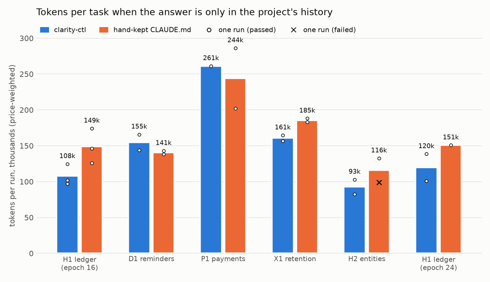

# clarity-ctl-eval

Does a coding agent do better with project memory when the answer is only in the project's history,
not in the code? This is the test behind the "Does it work?" claim in
[clarity-ctl](https://github.com/danishnxt/clarity-ctl#does-it-work).

## How it was made

- **A made-up project.** Claude Code (Sonnet) built `meterbill`, a small Python billing library, over 24 sessions.
  Along the way the requests made decisions, reversed some, and left work half done. All of that was said in the
  sessions and kept out of the code.
- **Three kinds of memory.** After each session, an agent updated one of: nothing (code and git only), a hand-kept
  CLAUDE.md, or clarity-ctl.
- **Tasks.** Fresh agents then got coding tasks that depend on that history, with one kind of memory each. Hidden
  tests grade the result, including tests that catch the fix you'd write without knowing the history.

## Result

When the answer was only in the history, no memory passed 0/3 runs, a hand-kept CLAUDE.md 11/12 and clarity-ctl 12/12,
with clarity-ctl using 17% fewer tokens than CLAUDE.md. When the answer was in the code, every setup passed and memory
only added cost. Samples are small: 1-3 runs per task.

<picture>
  <source media="(prefers-color-scheme: dark)" srcset="eval-dark.png">
  
</picture>

## What's here

- `story.yaml`: the 24 sessions and the tasks, written before the runs
- `arms.md`: the three memory setups
- `tasks/`: hidden tests and trap patches
- `results/`: every transcript (scrubbed of personal details) and the result tables
- `harness/`: the scripts that ran it

The full method, every number, the limits and how to rerun it are in [METHOD.md](METHOD.md).

clarity-ctl includes this repo as a submodule at `eval/meterbill`. It lived in that folder until 2026-11-23, so its
history starts there.
